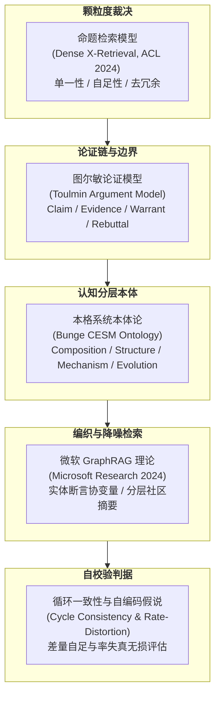

# gewuz-extract 学理支柱与方法论奠基 (Theoretical Foundations)

本手册承载格物志常青原子萃取（`gewuz-extract`）背后的五大学术理论支柱。将长篇客观长文熔炼为高质量常青记忆卡片，并非随意剪裁或凭空臆造，而是根植于计算语言学、科学哲学、知识工程与信息检索领域的严肃学术沉淀。

---

## 1. 微观切分颗粒度理论：命题检索模型 (Proposition Retrieval)

在长文解构中，切分颗粒度的大小直接决定了下游图谱检索的召回率与推理信噪比。斯坦福大学与华盛顿大学联合发表于 ACL 2024 的代表性研究确立了命题切分的理论基础：

- **核心文献**：*Dense X-Retrieval: What Retrieval Granularity Should We Use?* (Chen et al., ACL 2024)
- **理论论据**：研究团队系统对比了篇章级 (Document)、段落级 (Passage)、句子级 (Sentence) 与命题级 (Proposition) 切片对检索性能的影响，严格证明 **原子命题 (Proposition)** 是文本检索的最优最小自包含单元。一个合格的原子命题必须同时满足 3 个硬性条件：
  1. **单一性 (Singularity)**：仅表达一个独立的客观事实、机制或核心论断，不可多事混杂；
  2. **自足性 (Self-Sufficiency)**：彻底展开代词（如「该系统」、「此协议」还原为全称实体名）与缺失的主谓成分，脱离原段落上下文后读者亦能无歧义理解；
  3. **去冗余 (De-redundancy)**：彻底剥除修辞垫话、背景铺垫与过渡短语，实现语义密度最大化。
- **工程映射**：实验证明，命题级切片较传统段落检索准确率大幅跃升，且输入大模型上下文时的无关噪声降低 60% 以上。格物志的原子卡片即是命题检索模型在工程上的具体实现。

---

## 2. 因果链与边界抽取理论：图尔敏论证模型 (Toulmin Model)

原子卡片严禁仅记录孤立结论，必须交代前置假设与推导机理。计算语言学中论证采掘 (Argument Mining) 与知识工程权威模型提供了严密框架：

- **核心文献**：*The Uses of Argument* (Stephen Toulmin, 剑桥大学出版社) 与生物医学知识工程权威论文 *Micropublications: a semantic model for claims, data, meanings and arguments in scientific publishing* (Clark et al., 2014)
- **理论论据**：图尔敏将人类严肃论证解构为要素体系，Micropublications 将其工程化为科学知识的本体抽取结构：
  1. **Claim (核心断言/命题)**：卡片的核心论点或功能定性；
  2. **Evidence / Data (事实证据)**：支撑断言的测试数据、实测基准、代码事实或权威技术标准条款；
  3. **Warrant (机制保证)**：连接证据与断言之间的推理逻辑与技术机理（回答「为什么这些证据能推导出该断言」）；
  4. **Backing (底层支撑)**：该推理机制赖以成立的更底层科学定理、公理或行业标准依据；
  5. **Qualifier / Rebuttal (边界条件与例外反例)**：该断言失效的反例、限制边界、性能代价或未决边界条件。
- **工程映射**：卡片正文必须交代论证要素。缺少 Warrant（机理）与 Rebuttal（边界条件/代价）的卡片不是常青原子知识，只是碎片断言。

---

## 3. 认知阶梯理论：本格系统本体论 (Bunge's Systemist Ontology)

知识库自底向上划分为实体、机制、时序与架构权衡，并非主观经验臆造，而是系统本体论在认知图谱上的投射：

- **核心文献**：*Treatise on Basic Philosophy: Ontology* (Mario Bunge, 1977/1979) 与顶级形式本体论 (BFO / DOLCE)
- **理论论据**：哲学家与物理学家马里奥·本格阐明，理解任何复杂系统必须遵循自底向上的层级递进（CESM 模型）：
  1. **Composition (组分)**：系统由哪些基本实体和概念构成 $\rightarrow$ 对应 **L1 概念基石** 与 **L2 主体构件**；
  2. **Structure (结构与规则)**：组分之间的静态关系、约束协议与配置矩阵 $\rightarrow$ 对应 **L3 机制规则**；
  3. **Mechanism (机制与过程)**：系统内部发生的状态转化、端到端动态闭环与履约时序 $\rightarrow$ 对应 **L4 动态时序**；
  4. **Environment & Evolution (环境与演化)**：系统在外部环境约束下的全局表现、高维权衡取舍与设计范式 $\rightarrow$ 对应 **L5 范式权衡**。
- **工程映射**：阶梯结构是现实世界复杂工程系统的认知镜像。缺少低阶组分，机制就会悬空；缺少高阶机制，概念就会变成死板字典。

---

## 4. 拓扑编织与降噪检索理论：微软 GraphRAG 与分层社区摘要 (GraphRAG)

长篇文献打散后通过 MOC 拓扑编织再检索，其性能显著优于暴力全文检索与纯向量切片检索：

- **核心文献**：*From Local to Global: A Graph RAG Approach to Query-Focused Summarization* (Edge et al., Microsoft Research, 2024)
- **理论论据**：传统向量切片 RAG 丢失了全局语义拓扑，在跨文档宏观推理中极易产生偏见与幻觉。GraphRAG 证明：
  1. 从长文中提取原子实体、关系与断言协变量 (Covariates)；
  2. 利用聚类算法构建分层的图拓扑社区；
  3. 为不同层级的社区生成分层摘要报告（即系统化 MOC）。
- **工程映射**：回答宏观推理和复杂机制问题时，先定位图谱社区摘要（MOC），再深入调用局部事实节点（Atomics），在信噪比与准确度上实现双重飞跃。

---

## 5. 循环一致性校验理论：自编码假说与率失真模型 (Cycle Consistency & Rate-Distortion)

在确认提取出的卡片没有遗漏关键信息且无幻觉的机制上，源于机器学习与信息论基础理论：

- **核心理论**：**Cycle Consistency**（循环一致性，源于 CycleGAN 理论）与信息论 **Rate-Distortion Theory**（率失真理论）
- **判定模型**：将长文原子化视为有损压缩编码器 (Encoder)，将通过卡片与拓扑复原原文关键推论视为解码器 (Decoder)：

$$\text{Original Text} \xrightarrow{\text{Extractor (Encoder)}} \{\text{Atomics, MOC}\} \xrightarrow{\text{Verifier (Decoder)}} \text{Core Delta Proof}$$

- **工程映射**：如果仅从生成的原子卡片组中能够完整覆盖原文的核心专有参数、履约时序与非共识权衡，即证明在切分过程中没有发生关键信息漂移。在现代 LLM 时代，此项校验从全文本逆向解码演进为 **差量知识核检 (Delta Checklist)**，既保持了信息论上的自足无损，又彻底根除了巨量 Token 消耗。
