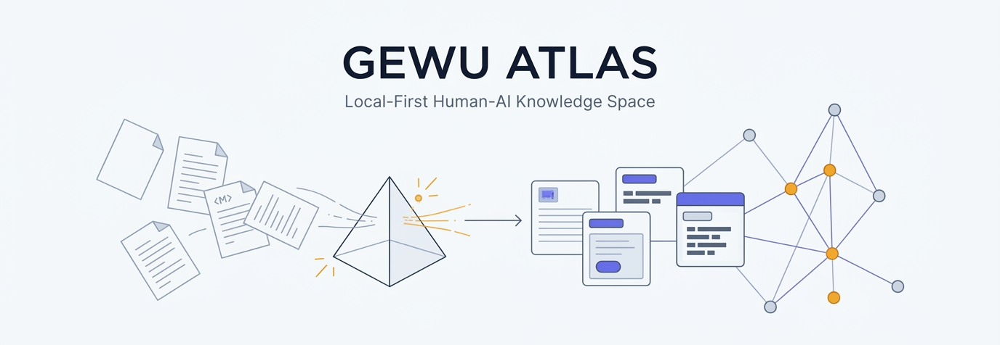

# 格物志（Gewu Atlas）

> 本地优先的人机协同认知空间。AI 帮忙整理沉淀，人负责思考。

---



## 为什么做格物志

知识管理崩掉，往往不是方法不对，而是卡在几个很日常的瞬间：

- **目录焦虑**：先花力气设计一套完美分类，真要归档时又纠结该塞进哪个抽屉；文件放进去，从此再也翻不到。
- **洁癖崩塌**：项目库刚整理完时井井有条，忙过一阵便乱成废墟，最后索性整个放弃。
- **聊天黑洞**：和工具聊了几小时，思路终于聊通了，结论却沉在记录深处，回头根本搜不出来。
- **金句蒸发**：某个瞬间冒出一句让自己顿悟的话，隔天醒来全忘干净，也没留下痕迹。
- **塑料报告**：深度研究熬出一版报告，满篇浮夸、真假难辨，原始资料反倒找不回来了。

---

## 格物志的解法

不换软件，也不改变既有习惯，直接搭在你已经在用的 Obsidian 上。

- **底层容器**：纯本地 Obsidian 库，标准 Markdown，原生配合 `.base` 看板与 `.canvas` 白板。
- **组织方式**：原子卡片盒（Zettelkasten）＋ 自主织网（MOC / LLM Wiki）。
- **工作流**：随手丢入（或投递链接）→ 自动转译与 AST 切片 → 蒸馏原子卡 → 缝合双链网络 → 门禁验货交付。
- **立场**：AI 在后台持续整理、对抗杂乱；知识的归属、审批与最终解释权，始终在人手里。

---

## 设计初衷

卡片盒这套方法几十年前就有，但一直是少数人的硬核手艺。常听人说 AI 带来了知识平权，可真到自己想接得住时才发现，工具、整理和维护的门槛并没有降下来。

格物志想做的，是把这份门槛尽量压低，换一种更顺着人性来的认知方式：

- **零摩擦**：不用手动搬运归类，也不打断手头的思路，系统通过后台算子自动对齐索引与双链。
- **零污染**：禁止在工作区根目录乱建临时目录；入库前有 Schema、断链与审批边界门控（60 分硬底线 + 40 分盲审/自评），守住库的干净与秩序。
- **零丢失**：新知不直接覆盖旧识，所有改写留存快照与行级 Diff，支持一键撤回；`05-Journal/` 日记永久只归档不删除——历史本身也是信息。

---

## 五步上手

无需复杂配置，初始化环境后五句对话即可跑起来。更多场景与可直接复制的提示词见 [QUICK_START.md](./QUICK_START.md)。

### 准备工作

#### 第一步：获取项目并执行 `GewuInitTools` 初始化

克隆本仓库进入工作区根目录后，先运行对应平台的初始化脚本（自动装配 `.runtime/` 独立 Python 环境、同步 `.agents/skills/` 技能发现链接、生成统一启动器 `gewu.command` / `gewu.cmd`；详细参数见 [INSTALL.md](./INSTALL.md)）：

- **GitHub**：
  ```sh
  git clone https://github.com/gewuz/gewu-atlas.git gewu-workspace
  cd gewu-workspace
  ```
- **Gitee（国内镜像）**：
  ```sh
  git clone https://gitee.com/gewuz/gewu-atlas.git gewu-workspace
  cd gewu-workspace
  ```

- **macOS**：
  ```sh
  sh GewuInitTools/Gewu_init_mac.sh
  ```
- **Linux**：
  ```sh
  sh GewuInitTools/Gewu_init_linux.sh
  ```
- **Windows**：
  ```bat
  GewuInitTools\Gewu_init_win.cmd
  ```

#### 第二步：挂载到 Agent 客户端

将当前工作区目录挂载到你常用的任意 Agent 客户端（OpenCode、Claude Code、Codex、Gemini、Cursor 等）。

---

### 第一句：创建知识库

在 Agent 客户端输入：

> 创建 vault，名字叫格物致知

创建完成后，Agent 会返回知识库逻辑句柄（如 `vlt_01`）。打开 Obsidian → 选择「打开本地仓库」→ 选中 `Volumes/GewuAtlas-data/` 下对应生成的知识库目录。

此时你会看到一个清晰的分形目录骨架：

```text
<Vault>/
├── 00-DropZone/            # 随手扔待处理资料的入口
├── 05-Journal/             # 人机分栏日记（只归档不删）
├── 10-Index/               # Obsidian .base 看板与总览说明
├── 20-AI-Zone/             # AI 默认知识沉淀区
│   ├── 10-Artifacts/       # 采收定稿的高维成果报告
│   ├── 20-Memory/
│   │   ├── 21-Library/     # 完整保留的一手原文与转译文稿
│   │   ├── 22-Atomics/     # 萃取沉淀的原子卡片
│   │   ├── 23-MOC/         # 主题内容地图（知识索引网络）
│   │   ├── 24-Slices/      # 原文 AST 结构化切片与 TOC
│   │   └── 97-Attic/       # 已废弃/替代的历史卡片冷存区
│   ├── 25-Slip/            # 书签批注衍生卡片
│   └── 30-Workbench/       # 临时草稿沙盒
├── 30-Projects/            # 独立课题研究域（含同构骨架与 ws-<agent> 隔离工作台）
├── 90-System/              # 模板与变更日志（Changes 后悔药 Diff）
└── 99-Assets/              # 附件（10-Attachments）与冷归档（98-Archives）
```

> 建议新建对话后，携返回的逻辑句柄（如 `vlt_01`）开展日常读写与检索。

### 第二句：新文件入库

将任意格式文件（Markdown、PDF、Docx、Excel、PPT、HTML、图片等）放入该库的 `00-DropZone/`，或直接把网页 URL 发给 Agent。

在 Agent 客户端输入：

> 新文件入库

观察现象：文件经转译后进入 `20-AI-Zone/20-Memory/21-Library/` 并保留完整原文，切分生成 `24-Slices/` 切片，蒸馏出的原子卡片沉淀在 `22-Atomics/`，主题地图生成于 `23-MOC/`，双链与 `10-Index/` 下的 `.base` 看板同步刷新。

### 第三句：自主深度研究

在 Agent 客户端输入：

> 我要研究 XXX 课题，开立课题工作台帮我自主调研，沉淀原子卡并产出调研报告

AI 会在 `30-Projects/` 下创建独立课题与隔离工作台 `ws-<agent>`，检索并实读一手资料入 `21-Library/`、切片萃取并织入 MOC，随后在工作台草稿区撰写结构清晰的调研报告（可采收进 `10-Artifacts/`）。报告中的核心论点均绑定真实 `nte_XX` 句柄与本地 `[[双链]]`，经 60 分算子硬评估与盲审/自评后才可交付。

### 第四句：书签协同交互

在 Obsidian 中打开刚才生成的报告或任意笔记，遇到想深挖、求证或延展的概念，直接用书签语法标记，例如：

`==@详细解释这个名词==`（兼容全半角符号及 `@@详细解释这个名词@@`）

在 Agent 客户端输入：

> 扫描"文档标题"的书签

切回 Obsidian，原来的 `==@详细解释这个名词==` 已经自动变成带别名的 `[[Slip-...|详细解释这个名词]]` 双链。点开它，AI 为你定制的深度解析卡片已经沉淀在 `25-Slip/` 中，并与原文档双向链接。

### 第五句：开启探索

在 Agent 客户端输入第五句指令：

> 我对你很感兴趣，我还想探索，告诉我下一步做什么？

---

## 核心概念（GewuAtlas）

理解格物志的运行方式，记住三个核心层级即可：

- **工作空间（Workspace）**：Agent 所在的根目录，提供统一门面网关 `./gewu.command`（Windows 为 `.\gewu.cmd`）与初始化工具 `GewuInitTools/`。
- **格物志域（`GewuAtlas`）**：由规则字典（`rules/` + `dicts/`）、8 个高内聚业务技能（`skills/`：`atlas-qa`、`atlas-note`、`atlas-ingest-flow`、`atlas-project`、`atlas-ops`、`atlas-usecase`、`atlas-style`、`atlas-obsidian`）与门面算子构成，规定 Agent 守什么边界、用什么工具干活。
- **托管数据卷（`Volumes/GewuAtlas-data/`）**：存放所有本地知识库资产。Agent 仅通过逻辑句柄（`vlt_XX`、`prj_XX`、`nte_XX` 等）与受控算子加工数据，严禁越界扫描物理路径或向根目录写业务草稿。

```text
工作空间 (Workspace)
├── GewuInitTools/              # 一键环境初始化脚本
├── gewu.command / gewu.cmd     # 统一业务网关入口
├── GewuAtlas/                  # 格物志技能包（Rules + Dicts + 8 Skills + 算子）
└── Volumes/GewuAtlas-data/     # 纯本地 Obsidian 知识库数据卷
```

---

## 参与贡献

欢迎通过 Issue 反馈问题、分享实战 Usecase 配方，或直接提交 Pull Request 共建开源生态。

本项目基于 [MIT License](./LICENSE) 开源。
